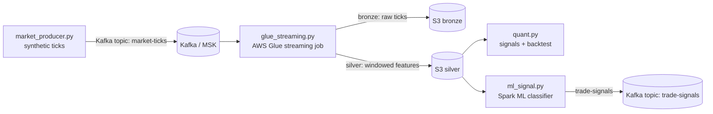

# auto-trading-quant-aws-glue

Quant research and real-time signal pipeline for an auto-trading firm workflow — built with **Python**, **PySpark Structured Streaming**, **Spark ML**, and **AWS Glue streaming**.

> ⚠️ **Disclaimer:** This project is for education and portfolio demonstration only. It uses **simulated market data** and textbook signals. It is **not financial advice** and nothing here should be used for real trading.

## What it does

1. **Market data simulation** — `market_producer.py` generates synthetic tick data (price, bid/ask, size) for a configurable symbol list and publishes to Kafka.
2. **Glue streaming ingestion** — `glue_streaming.py` reads ticks from Kafka, computes sliding-window features (avg price, volatility, VWAP, tick count) with watermarking, and writes bronze (raw) + silver (features) Parquet to S3. Runs as an AWS Glue streaming job, or locally on Spark.
3. **Quant research** — `quant.py` implements momentum (SMA crossover), mean-reversion (z-score), and RSI signals plus a vectorized backtester with commissions, Sharpe, and max drawdown.
4. **ML signals** — `ml_signal.py` trains Spark ML classifiers (Logistic Regression baseline + Random Forest) to predict next-window direction from streaming features, with strict no-lookahead labeling via `lead()`.

## Architecture



## Tech stack

- Python 3.11, PySpark 3.5 (Structured Streaming + MLlib)
- Kafka / AWS MSK, AWS Glue (streaming), S3 (Parquet)
- pandas, NumPy, matplotlib, boto3

## Quickstart

```bash
# 1. Install deps
pip install -r requirements.txt

# 2. Start Kafka locally (or point KAFKA_BOOTSTRAP at MSK)
docker compose up -d   # if you add a compose file, or use your own Kafka

# 3. Produce synthetic ticks
python src/market_producer.py --rate 0.5 --duration 300

# 4. Run the streaming job (local mode)
S3_BUCKET=./data spark-submit src/glue_streaming.py

# 5. Quant research
python -c "import sys; sys.path.append('src'); from quant import *; import pandas as pd"

# 6. Train the ML signal model (needs silver features on S3/local path)
spark-submit src/ml_signal.py

# 7. Open the notebook
jupyter notebook notebooks/quant_research.ipynb
```

### Environment variables

| Var | Default | Meaning |
|---|---|---|
| `KAFKA_BOOTSTRAP` | `localhost:9092` | Kafka / MSK bootstrap servers |
| `TICKS_TOPIC` / `SIGNALS_TOPIC` | `market-ticks` / `trade-signals` | Kafka topics |
| `SYMBOLS` | `AAPL,MSFT,NVDA,TSLA,SPY` | Symbols to simulate |
| `S3_BUCKET` | `s3://my-quant-bucket` | Output bucket (use `./data` locally) |
| `GLUE_JOB_NAME` | `quant-streaming-job` | Glue job name (logging) |
| `INITIAL_CAPITAL` | `100000` | Backtest starting capital |

## Backtesting

The backtester in `quant.py` is vectorized and intentionally simple: each bar holds `signal × max_position_pct` of capital, commissions are charged in basis points on position changes, and it reports total return, Sharpe (annualized), max drawdown, and trade count. On random-walk data you should expect ~zero edge — if a signal shows a big Sharpe on noise, that's a red flag for lookahead bias, not alpha.

## Project structure

```
src/
  config.py           # env-var settings (no secrets)
  market_producer.py  # synthetic tick generator -> Kafka
  glue_streaming.py   # Glue/Spark streaming: ticks -> S3 bronze/silver
  quant.py            # SMA / mean-reversion / RSI signals + backtester
  ml_signal.py        # Spark ML direction classifier
notebooks/
  quant_research.ipynb
```

## Future work

- Real market data adapter (with proper licensing) replacing the simulator
- Stateful signal execution with position tracking and risk limits
- Delta Lake + Glue Data Catalog for the silver/gold layers
- Hyperparameter tuning with cross-validation on walk-forward splits

## License

MIT — see LICENSE (add one if publishing).
