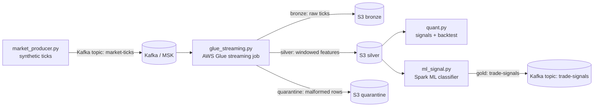

# auto-trading-quant-aws-glue

[](https://www.python.org/downloads/)
[](https://spark.apache.org/)
[](LICENSE)

Real-time quant research and signal pipeline for an auto-trading workflow — built with **Python**, **PySpark Structured Streaming**, **Spark ML**, and **AWS Glue streaming**.

> ⚠️ **Disclaimer:** This project is for education and portfolio demonstration only. All market data is **simulated**, and every signal is a textbook example. It is **not financial advice** and nothing here should be used for real trading or investment decisions.

## Installing as a package

The quant research library ships as the pip-installable `quantstream` package:

```bash
pip install quantstream
```

```python
from quantstream import momentum_signals, backtest

signals = momentum_signals(df, fast=10, slow=30)  # df needs a 'price' column
print(backtest(signals, commission_bps=2.0, slippage_bps=1.0))
```

CLI entry points are installed too: `quantstream-produce`, `quantstream-backtest`,
`quantstream-train`, `quantstream-sample-data`. See [docs/PACKAGING.md](docs/PACKAGING.md)
for how the artifact is built, checked, and published.

## Table of contents

- [Overview](#overview)
- [Architecture](#architecture)
- [Data model](#data-model)
- [Configuration reference](#configuration-reference)
- [Local development](#local-development)
- [Quick test without Kafka](#quick-test-without-kafka)
- [AWS deployment](#aws-deployment)
- [Code reference](#code-reference)
- [Testing](#testing)
- [Monitoring & operations](#monitoring--operations)
- [Backtesting methodology](#backtesting-methodology)
- [ML system design](#ml-system-design)
- [FAQ / troubleshooting](#faq--troubleshooting)
- [Roadmap](#roadmap)
- [License](#license)

## Overview

### Problem statement

A systematic trading desk needs two things that rarely live in the same codebase: a **low-latency streaming feature pipeline** that turns raw market ticks into research-ready features, and a **rigorous offline research loop** (signals, backtesting, ML) that can be trusted not to lie to you. This project implements both ends, end to end, with production discipline:

- Tick ingestion with schema enforcement and a quarantine path for bad rows
- Exactly-once-friendly streaming writes with checkpointing
- A vectorized backtester with explicit cost modeling
- Lookahead-bias safeguards in both the signal code and the ML labels

### Who it's for

- **Data engineers** wanting a realistic Spark Structured Streaming reference: watermarking, windowing, bronze/silver layering, and a Glue-compatible job layout.
- **Quant researchers** wanting a clean, testable backtesting harness with honest assumptions.
- **Hiring managers** — this repo is a portfolio piece demonstrating production Python: typed code, structured logging, config validation, tests, and operational runbooks.

### What makes it production-grade

- Fail-fast configuration validation (`Settings.validate()`)
- Structured logging everywhere; no stray `print()` in library code
- Graceful shutdown (SIGINT/SIGTERM) and Kafka retry with backoff in the producer
- Quarantine sink for malformed records instead of killing the stream
- Timestamped, versioned ML model artifacts with saved feature lists and metrics
- pytest suite covering the pure-Python research code (no Spark required to test)

## Architecture



### Component table

| Component | Input | Output | Where it runs |
|---|---|---|---|
| `market_producer.py` | Random-walk price model | JSON ticks → `market-ticks` Kafka topic | Any Python host / container |
| `glue_streaming.py` | Kafka topic `market-ticks` | Parquet: bronze (raw), silver (features), quarantine (bad rows) → S3 | AWS Glue 4.0 streaming job, or local Spark |
| `quant.py` | Silver Parquet (offline) | Signal frames + backtest reports | Notebook / laptop / CI |
| `ml_signal.py` | Silver Parquet (offline) | Versioned model artifacts + AUC metrics | Spark cluster / EMR / Glue |

### Data flow, step by step

1. **Produce.** `market_producer.py` generates synthetic ticks (price, bid/ask, size, exchange) for each symbol in `SYMBOLS` and publishes them as JSON to the `market-ticks` Kafka topic, rate-limited to a target ticks/sec.
2. **Parse.** The streaming job reads the topic and parses each payload with an **explicit schema** (`TICK_SCHEMA`) — never `inferSchema` in streaming, which can silently drift.
3. **Validate.** Rows with a null `symbol` (parse failures) are routed to the **quarantine** sink for later inspection instead of failing the job.
4. **Window.** Valid rows are watermarked on `event_time` (default 2 minutes) and aggregated per symbol over a sliding window (default 5-minute window, 1-minute slide) into `avg_price`, `volatility`, `tick_count`, and `vwap`.
5. **Land.** Bronze (raw ticks) and silver (windowed features) are written as Parquet to S3 in `append` mode, each with its own checkpoint directory.
6. **Research.** Offline, `quant.py` computes SMA-crossover, mean-reversion, and RSI signals on silver data and evaluates them with the cost-aware backtester. `ml_signal.py` trains direction classifiers on the same features with no-lookahead labels.

### Fault tolerance

- **Checkpointing:** every streaming query has its own checkpoint location. Never share a checkpoint between two streams — that is the classic way to corrupt state.
- **Watermarking:** bounds the amount of state the windowed aggregation keeps, so late data beyond the watermark is dropped rather than growing state forever.
- **Exactly-once:** Parquet `append` sinks with checkpointing give effectively-once semantics for file sinks (idempotent replays from the last committed offset). Kafka sources replay from the last committed offset on restart.
- **Quarantine:** malformed payloads never kill the stream; they land in quarantine Parquet for triage.
- **Producer retries:** the producer retries Kafka sends with exponential backoff and flushes on graceful shutdown, so a brief broker blip doesn't lose the batch in flight.

## Data model

### Bronze: raw ticks (`bronze/market-ticks`)

| Field | Type | Description |
|---|---|---|
| `symbol` | string | Ticker symbol, e.g. `AAPL` |
| `ts` | string (ISO-8601) | Producer timestamp, converted to `event_time` downstream |
| `price` | double | Last trade price |
| `bid` / `ask` | double | Best bid / ask around the price |
| `size` | long | Tick size (shares) |
| `exchange` | string | Venue, e.g. `NASDAQ`, `NYSE`, `ARCA` |
| `event_time` | timestamp | Derived from `ts`; used for watermarking |

### Silver: windowed features (`silver/features`)

One row per symbol per window:

| Field | Type | Description |
|---|---|---|
| `symbol` | string | Ticker symbol |
| `window_start` | timestamp | Start of the sliding window |
| `avg_price` | double | Mean price in the window |
| `volatility` | double | Stddev of price in the window |
| `tick_count` | long | Number of ticks in the window |
| `vwap` | double | Volume-weighted average price (`Σ(price×size)/Σ(size)`) |

### Gold: trade signals (`trade-signals` topic / `gold/signals`)

| Field | Type | Description |
|---|---|---|
| `symbol` | string | Ticker symbol |
| `window_start` | string | Window the signal was computed on |
| `signal` | int | `1` long, `0` flat, `-1` short |
| `model_version` | string | Timestamped model version that produced it |

## Configuration reference

Every setting is an environment variable with a sane local default. Copy `.env.example` to `.env` and adjust.

| Variable | Default | Required? | Description |
|---|---|---|---|
| `KAFKA_BOOTSTRAP` | `localhost:9092` | No | Kafka / MSK bootstrap servers |
| `TICKS_TOPIC` | `market-ticks` | No | Input topic for raw ticks |
| `SIGNALS_TOPIC` | `trade-signals` | No | Output topic for ML signals |
| `SYMBOLS` | `AAPL,MSFT,NVDA,TSLA,SPY` | No | Comma-separated symbols to simulate/subscribe |
| `WATERMARK` | `2 minutes` | No | Spark watermark for late data |
| `WINDOW` | `5 minutes` | No | Sliding window length |
| `SLIDE` | `1 minute` | No | Sliding window step |
| `TRIGGER_SECONDS` | `30` | No | Micro-batch trigger interval (seconds, > 0) |
| `S3_BUCKET` | `s3://my-quant-bucket` | Yes (AWS) | Output bucket; use `./data` for local runs |
| `CHECKPOINT_ROOT` | `./checkpoints` | No | Local or S3 root for stream checkpoints |
| `GLUE_JOB_NAME` | `quant-streaming-job` | No | Glue job name (used in logging) |
| `INITIAL_CAPITAL` | `100000` | No | Backtest starting capital (must be > 0) |
| `MAX_POSITION_PCT` | `0.1` | No | Max fraction of capital per position, in (0, 1] |
| `COMMISSION_BPS` | `2` | No | Commission in basis points per trade (≥ 0) |
| `SLIPPAGE_BPS` | `1` | No | Slippage in basis points per trade (≥ 0) |

`Settings.validate()` fails fast on empty `SYMBOLS`, non-positive capital, `MAX_POSITION_PCT` outside (0, 1], or negative costs — so a typo'd env var errors at startup, not mid-stream.

## Local development

### Prerequisites

- Python 3.11
- Docker (for local Kafka) or an existing Kafka/MSK cluster
- Java 8/11/17 (for local Spark)

### Step by step

```bash
# 1. Install (use a venv)
make install

# 2. Start local Kafka
docker compose up -d          # or: docker-compose up -d
# verify the broker is listening:
# (kafka-)bin/kafka-topics.sh --bootstrap-server localhost:9092 --list

# 3. Produce synthetic ticks (60 seconds, ~2 ticks/sec/symbol)
make producer
# verify: you should see "sent N ticks" and per-second rate logs

# 4. Run the streaming job locally (writes Parquet under ./data)
S3_BUCKET=./data make stream
# verify: ./data/bronze/market-ticks and ./data/silver/features fill with parquet files

# 5. Run the test suite
make test

# 6. Backtest the textbook signals on silver data
make backtest

# 7. Open the research notebook
jupyter notebook notebooks/quant_research.ipynb
```

Each step prints a short summary (rows written, files landed, metrics) so you can confirm it worked before moving on.

## Quick test without Kafka

No Kafka? No problem — the repo ships a committed sample dataset so the
research code is testable in seconds:

**How the data was generated:** `data/sample_ticks.csv` (500 rows, ~32KB) was
produced by `quantstream/generate_sample_data.py` with a fixed seed (`42`),
so it is byte-identical on every run. Three symbols (`AAPL`, `MSFT`, `NVDA`),
one tick every 3 seconds, gentle random-walk prices. Regenerate it any time:

```bash
python -m quantstream.generate_sample_data --rows 500 --out data/sample_ticks.csv
```

**Schema:** `ts` (ISO-8601 UTC), `symbol`, `price`, `bid`, `ask`, `size`,
`exchange` — the same fields as the bronze tick schema, minus the derived
`event_time`.

**What you can run against it (no broker needed):**

```bash
make test        # pytest: signals, backtester, walk-forward splits, CSV checks
make backtest    # momentum + mean-reversion backtests on the sample CSV
```

The Spark streaming job and ML training still need Kafka/Spark — the sample
CSV covers the pure-Python research path (signals, backtesting, validation
logic).

## AWS deployment

### 1. Networking & MSK

- Create an MSK cluster (or MSK Serverless) in the same VPC as your Glue jobs.
- Note the bootstrap servers (TLS) and set `KAFKA_BOOTSTRAP` accordingly.
- Security groups must allow Glue → MSK on port 9092 (plaintext) or 9094 (TLS).

### 2. IAM

The Glue job needs an IAM role with:

- `AWSGlueServiceRole` managed policy
- S3 read/write on your data bucket (`s3://my-quant-bucket/*`)
- MSK read on the cluster (`kafka-cluster:Connect`, `kafka-cluster:DescribeTopic`, `kafka-cluster:ReadData`), or use IAM auth with `aws-msk-iam-auth`

### 3. S3 layout

```
s3://my-quant-bucket/
  bronze/market-ticks/     # raw ticks, partitioned by ingestion date
  silver/features/         # windowed features
  gold/signals/            # ML trade signals
  quarantine/              # malformed rows
  checkpoints/bronze/
  checkpoints/silver/
```

### 4. Glue streaming job

1. Console → AWS Glue → ETL jobs → **Spark** job, type **Streaming**.
2. Glue version **4.0**, Python 3.10.
3. Worker type **G.1X**, 2–4 workers to start (scale on backlog).
4. Script: upload `src/glue_streaming.py` (plus `src/config.py` — set "Python library path" to include it, or package both as a zip in `--extra-py-files`).
5. Job parameters:

   | Key | Value |
   |---|---|
   | `--KAFKA_BOOTSTRAP` | your MSK bootstrap servers |
   | `--TICKS_TOPIC` | `market-ticks` |
   | `--S3_BUCKET` | `s3://my-quant-bucket` |
   | `--CHECKPOINT_ROOT` | `s3://my-quant-bucket/checkpoints` |
   | `--JOB_NAME` | `quant-streaming-job` |

6. Enable **job bookmarks** only if you switch the source to Kinesis; with Kafka the checkpoint dir is the source of truth.

### 5. CloudWatch alarms to set

- `glue.driver.heartbeat` / job failure → alert on `glue.job.run.failed`
- Consumer lag on `market-ticks` (MSK `EstimatedMaxTimeLag`) > 5 min → page
- S3 `silver/features` object count stalls for 2× trigger interval → investigate
- Quarantine row rate spikes → data quality issue upstream

## Code reference

The importable code lives in the `quantstream/` package (pip-installable);
`src/` holds thin backwards-compatible shims.

| Module | Key contents |
|---|---|
| `quantstream/config.py` | `Settings` dataclass, `from_env()` with type coercion, `validate()` (fail-fast), `symbol_list()`, `s3_path()`, `checkpoint_path()` |
| `quantstream/market_producer.py` | `tick()` builder, `make_producer()` with retry/backoff, `run()` with SIGINT/SIGTERM handling and accurate rate limiting |
| `quantstream/glue_streaming.py` | `TICK_SCHEMA`, `get_spark()` (Glue-or-local), `read_ticks()`, `split_quarantine()`, `add_features()`, `start_stream()` with error handling |
| `quantstream/quant.py` | `sma()`, `rsi()`, `momentum_signals()`, `mean_reversion_signals()`, `backtest()` (with slippage), `summarize()`, `main()` CLI |
| `quantstream/ml_signal.py` | `FEATURE_COLS`, `make_labels()` (no-lookahead via `lead()`), `validate_training_data()`, `tune_model()`, `train_walkforward()`, `load_latest_model()`, `profit_evaluation()` |
| `quantstream/splits.py` | `walk_forward_splits()` — Spark-free, unit-tested fold construction |
| `quantstream/generate_sample_data.py` | Reproducible sample tick CSV generator (`--rows`, `--out`, fixed seed) |
| `tests/test_quant.py` | pytest suite for signals, backtester, splits, and sample data (no Spark needed) |

## Testing

```bash
make test        # pytest tests/ -v
```

Covered (all pure-Python, no Spark required):

- SMA crossover signal shape and dtype
- Mean-reversion z-score signal bounds (`-1/0/1`)
- RSI stays within `[0, 100]`
- Flat prices → ~zero trades, ~zero return
- Commissions strictly reduce returns vs. zero-cost
- Slippage strictly reduces returns vs. zero-slippage
- Sharpe on a constant series is NaN-safe (no crash, finite/NaN handled)
- `summarize()` returns the expected metric keys
- Walk-forward folds: no overlap, validation strictly after training, deterministic
- Sample CSV: expected columns, rows > 0, prices > 0

## Monitoring & operations

**Metrics emitted (logs):**

- Producer: ticks/sec, total sent, Kafka retry count
- Streaming: per-trigger input rows, quarantine row count, checkpoint paths
- ML: per-model AUC, winning model, artifact path, feature list

**What to alert on:**

- No new silver Parquet files for > 2 trigger intervals → stream stalled
- Quarantine growth rate spike → upstream schema change or producer bug
- Backtest Sharpe suddenly large on random data → lookahead bias introduced

**Recovering from a corrupt checkpoint:** stop the job, delete (or rename) the affected checkpoint directory under `CHECKPOINT_ROOT`, and restart. The stream replays from `startingOffsets`. Never edit checkpoint files by hand.

## Backtesting methodology

The backtester (`quant.backtest`) is deliberately simple and transparent:

- **Positioning:** each bar holds `signal × max_position_pct` of capital (`signal ∈ {-1, 0, 1}`). No leverage beyond the cap, no compounding of position size within a bar.
- **Costs:** commissions (`COMMISSION_BPS`) are charged on absolute position changes; slippage (`SLIPPAGE_BPS`) models the bid/ask cost of entering/exiting. Both are subtracted from strategy returns every bar.
- **Returns:** strategy return per bar = `position.shift(1) × price_return − costs`. Using the *lagged* position is the key anti-lookahead rule: you only earn the return *after* you've taken the position.
- **Metrics:** total return, annualized Sharpe (252 trading days), max drawdown (peak-to-trough on the equity curve), trade count, final equity.

**How to interpret the numbers:** on random-walk data the expected Sharpe is ~0. A large positive Sharpe on noise is a red flag for lookahead bias, not alpha — check that signals only use data available at bar *t* (rolling windows use `min_periods`, labels use `lead()`).

**Assumptions & limitations:** no market impact, fills at close, fractional sizing allowed, constant costs. Real trading has impact, partial fills, and regime shifts — this harness is for comparing *research ideas*, not sizing real risk.

## ML system design

This is the section a quant hiring manager will actually read. The ML system
is designed around one principle: **never let the model see the future** —
in validation, in labeling, or in feature construction.

### Why walk-forward validation (no random splits)

A random 80/20 train/test split on time-series data is a credibility killer:
it trains on future windows and validates on past ones, which inflates metrics
and hides lookahead bias. Walk-forward validation instead rolls the training
window forward in time:

- The ordered timeline is cut into `N + 1` contiguous blocks (`N = 3` folds).
- Fold `i` trains on blocks `[0..i]` and validates on block `i + 1` only.
- Folds never overlap; validation is always strictly in the future.

This mimics how the model is actually used: retrained periodically on history,
then scored on unseen future data. We report **mean ± std of each metric
across folds** — the std tells you how stable the edge is across regimes, and
a model whose folds disagree wildly is not trusted no matter how good the
mean looks.

The split logic lives in `quantstream/splits.py` (Spark-free, unit-tested:
folds don't overlap, validation is always after training, splits are
deterministic regardless of input order).

### Model selection policy

Four Spark MLlib classifiers compete on identical walk-forward folds:

| Model | Role | Tuned hyperparameters |
|---|---|---|
| LogisticRegression | Baseline | `regParam`, `elasticNetParam` |
| RandomForestClassifier | Non-linear workhorse | `numTrees`, `maxDepth` |
| GBTClassifier | Gradient-boosted trees | `maxIter`, `maxDepth` |
| LinearSVC | Large-margin linear | `regParam` |

Each model gets a small, seeded `TrainValidationSplit` grid search on every
fold's training data (grids are deliberately small so retraining stays fast).
Selection rule: **highest walk-forward mean AUC wins; mean net P&L breaks
ties.** A model with 52% accuracy but positive net P&L after commissions beats
a 55% model that loses money — accuracy doesn't pay the bills, P&L does.

Sample comparison output (synthetic data — expect ~0.5 AUC; anything much
higher on noise would indicate leakage, not skill):

| Model | Mean AUC | Std AUC | Mean net P&L | Best params |
|---|---|---|---|---|
| logreg | 0.5123 | 0.0211 | $184.20 | regParam=0.01, elasticNetParam=0.0 |
| random_forest | 0.5087 | 0.0189 | -$42.10 | numTrees=100, maxDepth=8 |
| gbt | 0.5210 | 0.0245 | $310.55 | maxIter=50, maxDepth=3 |
| linear_svc | 0.4998 | 0.0152 | -$120.00 | regParam=0.1 |

*(Illustrative — run `quantstream-train` to reproduce on your data.)*

### Metrics reported per model

Classification: **AUC, accuracy, precision, recall, F1** (mean ± std across
folds). Profit: each fold's predictions are fed through the cost-aware
backtester (`quant.backtest` with commissions + slippage) to get **net P&L
and Sharpe per model** — the economic reality check.

### Experiment tracking

Every training run writes `runs/<utc-timestamp>/run.json` with: model name,
best params per model, feature list, data window (start/end), the single
global seed, a config hash, per-fold metrics for every model, and the
selection rationale. No MLflow dependency — plain structured JSON, but
complete enough to reproduce or audit any run.

### Registry layout

```
models/
  registry/
    <model_name>/
      v20260105/
        model/           # Spark PipelineModel
        metadata.json    # metrics, params, data window, seed, config hash
    LATEST               # text pointer: "<model_name>/v<date>"
  metrics.json           # latest run summary (best model + comparison)
runs/
  <utc-timestamp>/
    run.json             # full experiment manifest
```

`quantstream.ml_signal.load_latest_model()` resolves `LATEST` and returns the
champion `(PipelineModel, metadata)` — the only sanctioned way to load a
model for scoring.

### Reproducibility

One global seed (`GLOBAL_SEED = 42`, overridable via `--seed`) is threaded
through fold construction, `TrainValidationSplit`, and the tree-based models,
and is logged in every run manifest alongside the config hash.

### Data validation

`validate_training_data()` fails fast before any training: required columns
present, no nulls in features/label, both label classes present (a single
class means the classifier has nothing to learn), minimum row count.

### Adding a new model — checklist

1. Add an entry to `MODEL_SPECS` in `quantstream/ml_signal.py` with a
   `estimator` factory and a small `grid` dict.
2. Keep the grid tiny (≤ 4 combos) so retraining stays fast.
3. Run `make test` — existing tests must stay green.
4. Run a training pass and check `runs/<ts>/run.json` for the new model's
   fold metrics.
5. Update the model comparison table above with fresh numbers.

## FAQ / troubleshooting

**Kafka connection refused locally** — is the broker up? `docker compose ps` should show Kafka healthy, and `KAFKA_BOOTSTRAP` should match the mapped port (`localhost:9092`).

**`AnalysisException: cannot resolve 'ts'`** — a payload didn't match `TICK_SCHEMA`. Check the quarantine output; the producer and schema must agree on field names.

**Checkpoint corruption / `IllegalStateException`** — stop the job, delete the stream's checkpoint dir, restart. Don't share checkpoints between streams.

**Schema mismatch after a producer change** — the streaming job uses an explicit schema, so new fields are ignored until you add them to `TICK_SCHEMA` and the feature code.

**Backtest shows huge Sharpe on random data** — lookahead bias. Verify signals use only past data (`min_periods` set, no `shift(-1)` on features) and labels use `lead()`.

**Glue job can't reach MSK** — check the security group allows Glue → MSK on 9092/9094 and that the IAM role has the MSK actions listed above.

**Out of memory on Glue** — raise workers, or increase the trigger interval to cut micro-batch size; check `volatility` skew (one hot symbol) as a data cause.

## Roadmap

- [x] Walk-forward validation + model registry in `ml_signal.py`
- [x] pip-installable `quantstream` package ([docs/PACKAGING.md](docs/PACKAGING.md))
- [ ] Kinesis source option wired end-to-end in `glue_streaming.py`
- [ ] Great Expectations / Deequ data-quality checks on silver
- [ ] Airflow/MWAA orchestration for the offline research loop
- [ ] Delta Lake + `autoOptimize` on S3 for silver/gold
- [ ] Real order-book features (depth imbalance) in the producer

## License

MIT — see [LICENSE](LICENSE).

**Not financial advice.** Everything in this repository is simulated data and textbook examples for educational purposes. Do not use it for real trading.
